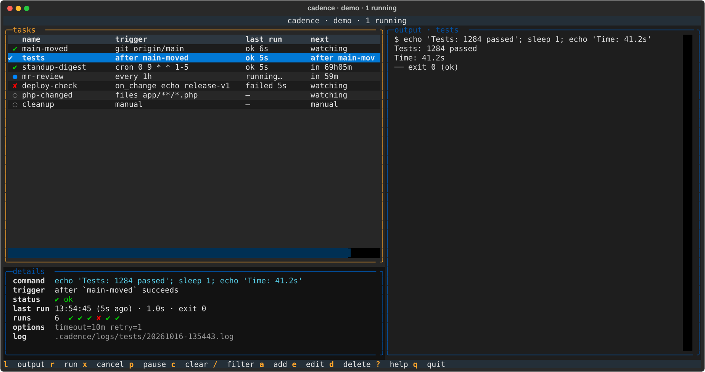

# Cadence

A keyboard-driven terminal dashboard for shell tasks that run on a rhythm: every hour, on a cron schedule, when a git branch moves, when files change, when another task finishes.



Think of it as a small, local, interactive alternative to a pile of `watch`, `cron` and `while true; do …; sleep` loops. You see every task and its status at a glance, pick one to read its live output, and add, edit, pause or cancel tasks without leaving the terminal. Everything is configured in one TOML file you can commit next to your code.

## Features

- **One screen:** task list with status, trigger, last and next run. Live output on the right, details (command, history, timings, log path) below the list.
- **Triggers:** interval, cron, git ref moved, command output changed, files changed, after another task succeeds or fails, or manual.
- **Vim-style keys:** `j/k`, `g/G`, `/` filter, `r` run, `x` cancel, `p` pause, `:` command palette.
- **Edit in place:** add, edit, re-trigger and delete tasks from the UI. Changes are written to `tasks.toml`, and edits to the file are hot-reloaded.
- **Reliable runs:** timeouts, retries with backoff, overlap policy (`skip`, `queue`, `kill`), a global parallelism limit, desktop notifications on failure.
- **Run history:** step through past runs of a task and diff a run against the one before it.
- **Resume:** quit and reopen later and schedules continue where they left off. A task due in 15 minutes, reopened 3 minutes later, is due in 12.
- **Per-project:** configuration lives in `.cadence/` in your repository, so each project has its own tasks.
- **Light and dark:** follows your terminal's background color.
- **Claude Code aware:** tasks that run `claude -p …` can show cost and session id.

## Install

Requires Python 3.11+ on macOS or Linux. Windows is not supported.

Cadence is not on PyPI yet. Install from a checkout:

```sh
git clone <repository-url> cadence
cd cadence
uv tool install .          # or: pipx install .
```

For development, run it straight from the checkout with `uv run cadence`.

## Quick start

```sh
cd your-project
cadence init     # creates .cadence/tasks.toml with a few example tasks
cadence          # opens the dashboard
```

Press `?` inside the dashboard for the key reference. To run it from a `justfile`:

```make
cadence:
    cadence
```

`cadence` finds `.cadence/tasks.toml` in the current directory or the nearest parent, so it works from any subdirectory. Use `-C <dir>` to point at another project.

## Configuration

`.cadence/tasks.toml`:

```toml
[cadence]
max_parallel = 4              # how many tasks may run at once (default 4)

[[task]]
name = "main-moved"
cmd = "git log -1 --oneline origin/main"
trigger = { git = "origin/main" }
notify = "always"

[[task]]
name = "tests"
cmd = "just test"
trigger = { after = "main-moved" }
timeout = "10m"
retry = 2

[[task]]
name = "digest"
cmd = "claude -p '/standup' --output-format json"
trigger = { cron = "0 9 * * 1-5" }
```

Every task needs `name`, `cmd` and `trigger`. Commands run through your shell from the project root. Output (stdout and stderr) is streamed to the dashboard and saved to `.cadence/logs/<task>/<timestamp>.log`.

### Triggers

| Trigger | Example | Fires |
| --- | --- | --- |
| `every` | `{ every = "30m" }` | After each run ends, plus the interval. Units: `s`, `m`, `h`, `d`. |
| `cron` | `{ cron = "0 9 * * 1-5" }` | On a cron schedule, in local time. |
| `git` | `{ git = "origin/main" }` | When the ref moves. Runs `git fetch origin` and checks every 60 s. |
| `on_change` | `{ on_change = "glab mr list" }` | When the command's output changes. Checked every 60 s. Good for "a new deploy happened". |
| `files` | `{ files = "app/**/*.php" }` | When a file matching the glob changes. Checked every 2 s. `**` is recursive. |
| `after` | `{ after = "build" }` | When the named task finishes successfully. |
| `failed` | `{ failed = "build" }` | When the named task fails or times out. |
| `manual` | `{ manual = true }` | Only when you press `r`. |

Watchers (`git`, `on_change`, `files`) record a baseline on their first check and fire only on later changes, so starting Cadence never triggers them. Chains have no cycle detection: `a` after `b` after `a` loops forever.

### Task options

All optional.

| Key | Default | Meaning |
| --- | --- | --- |
| `timeout` | none | Kill the run after this long (`"10m"`). Status becomes `timeout`. |
| `retry` | `0` | Extra attempts after a failure. |
| `retry_delay` | `"30s"` | Wait before the first retry. Doubles on each further retry. |
| `overlap` | `"skip"` | What a trigger does while the task is still running: `skip` ignores it, `queue` runs once more afterwards, `kill` cancels the current run and starts again. |
| `notify` | `"failure"` | Desktop notification: `failure`, `always` (also success and watcher fires) or `never`. |
| `paused` | `false` | Don't run on triggers. Toggled with `p`. |

### Notifications

macOS uses `osascript`. Linux uses `notify-send` if it is installed. Failures also appear as a toast in the dashboard. Set `CADENCE_NO_NOTIFY=1` to turn off desktop notifications entirely.

## Keys

| Key | Action |
| --- | --- |
| `j` `k` | Move down / up (scroll when the output pane is focused) |
| `g` `G` | Top / bottom |
| `Enter` `l` | Focus the output pane |
| `h` | Back to the task list |
| `/` | Filter tasks by name. `Enter` keeps it, `Esc` clears it |
| `r` | Run the selected task now |
| `x` | Cancel the running (or queued) task |
| `p` | Pause / resume the task |
| `c` | Clear the output pane |
| `a` `e` `t` `d` | Add, edit, edit trigger, delete |
| `[` `]` | Older / newer run. Past the newest returns to live output |
| `D` | Diff the shown run against the previous run |
| `Esc` | Leave history view |
| `y` | Copy `claude --resume <session>` (or the log path) |
| `:` | Command palette: run all, pause all, resume all, run a task |
| `T` | Toggle light / dark |
| `?` | Help |
| `q` | Quit (asks first; running tasks are cancelled) |

In the add/edit form, triggers are typed as `every 1h`, `cron 0 9 * * 1-5`, `git origin/main`, `after build`, `manual` and so on. Options are typed as `timeout=10m retry=2 notify=always`.

## Resume

While running, Cadence saves its state to `.cadence/logs/state.json` every second. When you start it again it asks whether to resume. Choosing yes restores next-run times, last results, run history and watcher baselines. A task that became due while you were away runs right away, and a watcher whose target changed in the meantime fires. State for a task is ignored if its trigger changed.

Tasks only run while Cadence is open. There is no background daemon.

## Status in your prompt or tmux

`cadence status` prints a one-line summary and is cheap enough for a status bar:

```sh
$ cadence status
cadence: 1 running · 1 failed · 3 ok
```

It prints `cadence: off` when the dashboard is not running (no state saved in the last 15 seconds).

```tmux
set -g status-right '#(cd #{pane_current_path} && cadence status)'
```

## Claude Code tasks

If a command looks like `claude … -p`, Cadence shows its cost and session id in the details pane. Add `--output-format json` so Claude Code prints a result line that contains `total_cost_usd` and `session_id`. Press `y` to copy the `claude --resume` command for the last run.

## Files

```
.cadence/
  tasks.toml     your tasks (commit this)
  .gitignore     ignores logs/
  logs/
    state.json   resume state
    <task>/      one .log file per run
```

## Limitations

- macOS and Linux only (uses `termios` and process groups).
- Saving from the dashboard rewrites `tasks.toml`, which drops comments. Edit the file by hand if you want to keep them.
- Poll intervals for `git`, `on_change` and `files` are fixed.
- Tasks do not run while the dashboard is closed.

## Development

```sh
uv run --group dev pytest
uv run cadence -C /path/to/project
```

The code is small: `core.py` (config, triggers, state), `app.py` (the Textual UI and run engine) and `cli.py`.

## License

[MIT](LICENSE)
